# Discord Badges Assets — SVG & CDN Archive

A searchable archive of **Discord badges, profile badge assets, official CDN URLs, SVGs and PNGs**. Includes Nitro badge tiers, Server Boost badges, Account Age, Streaming, Game Time, Game Variety, Gifting, legacy badges, developer/app badges, and other Discord profile badges.

> Independent community archive. Not affiliated with or endorsed by Discord Inc. Discord names, trademarks, and badge artwork belong to their respective owners.

## Why this repository?

- Direct Discord / Discord CDN asset URLs alongside local mirrors.
- Searchable names and structured metadata in [`data/badges.json`](data/badges.json).
- Every badge includes a legacy/status/obtainability classification.
- SVG is preferred whenever a known official SVG asset is available; some current badges are only exposed as PNG.
- A small sync/check script makes CDN breakage easy to detect.

## Status definitions

- **Legacy — Yes (official):** listed by Discord in the current Legacy Badges section.
- **Legacy — Yes (historical):** no longer issued and preserved here as a historical badge, but not listed in Discord's current Legacy section.
- **Unofficial API only:** not obtainable through Discord's official UI/program, but the former client API route is still reported working.
- **Removed:** Discord has decommissioned the badge and removed previously displayed instances from profiles.

> **HypeSquad House note:** Bravery, Brilliance and Balance are officially classified as legacy because the quiz is gone. As of October 13, 2026, the former `/hypesquad/online` API flow is still community-verified for all three houses. This is not an official acquisition method.

## Coverage

| Category | Count |
| --- | ---: |
| Profile, Legacy & App Badges | 19 |
| Account Age | 10 |
| Streaming | 10 |
| Game Time | 10 |
| Game Variety | 10 |
| Gifting | 6 |
| Nitro Subscription Tiers | 8 |
| Server Boost Tiers | 9 |
| Guild Tag preset SVGs | 41 |

**Total: 123 assets (82 profile/badge assets + 41 Guild Tag preset SVGs).**

<!-- guild-tags:start -->
## Guild Tag preset icons

Discord currently defines **41 Guild Tag badge kinds** in the client. This archive contains their SVG vector renders: **10 free Server Tags icons, 20 Badge Pack icons, and 11 legacy Guild experiment icons**.

> Guild Tag badges served for a specific server use Discord's `guild-tag-badges/{guild_id}/{badge_hash}` CDN route, whose documented image formats are raster (PNG/JPEG/WebP), not SVG. The files below are the preset/client vector assets, cross-checked against two public Discord asset archives and the current client enum.

### Free Server Tags icons

| Preview | Name | Kind ID | Archive ID | Colors |
| --- | --- | ---: | ---: | ---: |
| 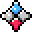 | **Compass** | `9` | `12` | 2 |
| 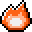 | **Fire** | `8` | `13` | 1 |
|  | **Heart** | `7` | `14` | 1 |
|  | **Leaf** | `6` | `15` | 1 |
|  | **Lightning** | `5` | `16` | 1 |
|  | **Moon** | `4` | `17` | 1 |
| 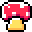 | **Toadstool** | `3` | `18` | 2 |
|  | **Skull** | `2` | `19` | 1 |
| 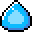 | **Water Drop** | `1` | `20` | 1 |
| 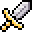 | **Sword** | `0` | `21` | 2 |

### Badge Pack — Pets

| Preview | Name | Kind ID | Archive ID | Colors |
| --- | --- | ---: | ---: | ---: |
|  | **Bunny** | `21` | `22` | 1 |
|  | **Dog** | `22` | `23` | 2 |
| 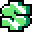 | **Frog** | `23` | `24` | 2 |
| 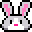 | **Goat** | `24` | `25` | 1 |
| 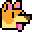 | **Cat** | `25` | `26` | 1 |

### Badge Pack — Flex

| Preview | Name | Kind ID | Archive ID | Colors |
| --- | --- | ---: | ---: | ---: |
| 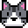 | **Diamond** | `26` | `27` | 1 |
| 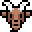 | **Crown** | `27` | `28` | 2 |
|  | **Trophy** | `28` | `29` | 1 |
|  | **Money Bag** | `29` | `30` | 1 |
| 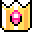 | **Dollar Sign** | `30` | `31` | 1 |

### Badge Pack — Plant

| Preview | Name | Kind ID | Archive ID | Colors |
| --- | --- | ---: | ---: | ---: |
| 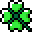 | **Clover** | `31` | `32` | 1 |
| 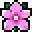 | **Blossom** | `32` | `33` | 1 |
| 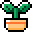 | **Potted Plant** | `33` | `34` | 2 |
|  | **Maple** | `34` | `35` | 1 |
| 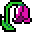 | **Wilted Flower** | `35` | `36` | 2 |

### Badge Pack — Creepy Crawlies

| Preview | Name | Kind ID | Archive ID | Colors |
| --- | --- | ---: | ---: | ---: |
| 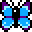 | **Butterfly** | `36` | `37` | 2 |
| 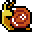 | **Snail** | `37` | `38` | 2 |
| 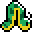 | **Caterpillar** | `38` | `39` | 2 |
| 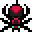 | **Spider** | `39` | `40` | 2 |
| 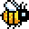 | **Bee** | `40` | `41` | 1 |

### Legacy Guild experiment icons

These 11 icons were part of the earlier Guild Tags experiment and are not in the current free/purchasable icon sets.

| Preview | Name | Kind ID | Archive ID | Colors |
| --- | --- | ---: | ---: | ---: |
| 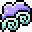 | **Wind** | `20` | `1` | 2 |
| 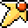 | **Sun** | `19` | `2` | 2 |
| 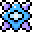 | **Sound** | `18` | `3` | 2 |
| 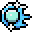 | **Snow** | `17` | `4` | 2 |
| 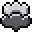 | **Smoke** | `16` | `5` | 2 |
| 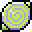 | **Psychic** | `15` | `6` | 2 |
| 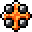 | **Lava** | `14` | `7` | 2 |
| 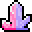 | **Gem** | `13` | `8` | 2 |
|  | **Force** | `12` | `9` | 2 |
| 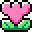 | **Flower** | `11` | `10` | 2 |
| 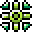 | **Crosshairs** | `10` | `11` | 2 |

Metadata, hashes, source mirrors and client enum IDs are in [`data/guild-tags.json`](data/guild-tags.json).

<!-- guild-tags:end -->

## Profile, Legacy & App Badges

| Preview | Badge | Legacy | Obtainability | Format | Discord CDN |
| --- | --- | --- | --- | --- | --- |
|  | **Discord Staff** | No | Official | `SVG` | [Open asset](https://discord.com/assets/48d5bdcffe9e7848067c2e187f1ef951.svg) |
|  | **Partnered Server Owner** | Yes (official) | No longer obtainable | `SVG` | [Open asset](https://discord.com/assets/34306011e46e87f8ef25f3415d3b99ca.svg) |
|  | **HypeSquad Events** | Yes (official) | No longer obtainable | `SVG` | [Open asset](https://discord.com/assets/e666a84a7a5ea2abbbfa73adf22e627b.svg) |
|  | **HypeSquad Bravery** | Yes (official) | Unofficial API only | `SVG` | [Open asset](https://discord.com/assets/efcc751513ec434ea4275ecda4f61136.svg) |
|  | **HypeSquad Brilliance** | Yes (official) | Unofficial API only | `SVG` | [Open asset](https://discord.com/assets/ec8e92568a7c8f19a052ef42f862ff18.svg) |
|  | **HypeSquad Balance** | Yes (official) | Unofficial API only | `SVG` | [Open asset](https://discord.com/assets/9f00b18e292e10fc0ae84ff5332e8b0b.svg) |
|  | **Bug Hunter Level 1** | No | Official | `SVG` | [Open asset](https://discord.com/assets/8353d89b529e13365c415aef08d1d1f4.svg) |
|  | **Bug Hunter Level 2** | No | Official | `SVG` | [Open asset](https://discord.com/assets/f599063762165e0d23e8b11b684765a8.svg) |
|  | **Early Supporter** | Yes (official) | No longer obtainable | `SVG` | [Open asset](https://discord.com/assets/b802e9af134ff492276d94220e36ec5c.svg) |
|  | **Early Verified Bot Developer** | Yes (historical) | No longer obtainable | `SVG` | [Open asset](https://discord.com/assets/4441e07fe0f46b3cb41b79366236fca6.svg) |
|  | **Moderator Programs Alumni** | Yes (official) | No longer obtainable | `SVG` | [Open asset](https://discord.com/assets/c981e58b5ea4b7fedd3a643cf0c60564.svg) |
|  | **Active Developer** | No | Removed | `SVG` | [Open asset](https://discord.com/assets/26c7a60fb1654315e0be26107bd47470.svg) |
|  | **Discord Nitro** | No | Official | `SVG` | [Open asset](https://cdn.discordapp.com/assets/content/f61ddf640d11d9bdfaf9de265eb862edf28986b659e545f293b54adf229433af.svg) |
|  | **Supports Commands** | No | Official | `SVG` | [Open asset](https://discord.com/assets/498591d63b352256a1bf18061eff9d57.svg) |
|  | **Uses AutoMod** | No | Official | `SVG` | [Open asset](https://discord.com/assets/8599b8b3d7917b5e7180e898a835f780.svg) |
|  | **Completed a Quest** | No | Official | `PNG` | [Open asset](https://cdn.discordapp.com/badge-icons/7d9ae358c8c5e118768335dbe68b4fb8.png) |
|  | **Legacy Username** | Yes (official) | No longer obtainable | `PNG` | [Open asset](https://cdn.discordapp.com/badge-icons/6de6d34650760ba5551a79732e98ed60.png) |
| 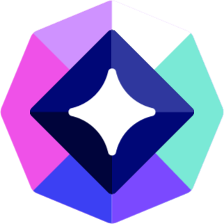 | **Orbs Apprentice** | No | Official | `PNG` | [Open asset](https://cdn.discordapp.com/assets/content/615334270467aa3d5adc86cc67efee89f8380a87b945a96e89ec2eb37c27993d.png) |
|  | **App Premium** | No | Official | `PNG` | [Open asset](https://cdn.discordapp.com/badge-icons/d2010c413a8da2208b7e4f35bd8cd4ac.png) |

## Account Age

| Preview | Badge | Milestone | Legacy | Format | Discord CDN |
| --- | --- | --- | --- | --- | --- |
|  | **Seed** | 1 year | No | `SVG` | [Open asset](https://cdn.discordapp.com/assets/content/dda73966211a0c16533f8fcd9f1f27c27a628ef562927270e79df9b9c5e6cb12.svg) |
|  | **Sprout** | 2 years | No | `SVG` | [Open asset](https://cdn.discordapp.com/assets/content/74e1884f930b0d69986f92aeea77d3ff3d3d00c540f386b63e6ebb382d5e927d.svg) |
|  | **Bud** | 3 years | No | `SVG` | [Open asset](https://cdn.discordapp.com/assets/content/217dab12dcb72d4c95f2863e9dddd5c42003345a001684ea55a736172f32eea1.svg) |
|  | **Sapling** | 4 years | No | `SVG` | [Open asset](https://cdn.discordapp.com/assets/content/26b89419a4f562ab31a1a72eac04833aa1026af937f1d53c088ec258df3db84b.svg) |
|  | **Blossom** | 5 years | No | `SVG` | [Open asset](https://cdn.discordapp.com/assets/content/1db184b6d10a61a37dc30efdc74d587560fac5291c8bb329977e93bb5a312602.svg) |
|  | **Redwood** | 6 years | No | `SVG` | [Open asset](https://cdn.discordapp.com/assets/content/6b0f2ed5be272942eeabea3a0289027d164c7b1ce6a76166d1c928a57db762c5.svg) |
|  | **Sequoia** | 7 years | No | `SVG` | [Open asset](https://cdn.discordapp.com/assets/content/c095e3e73591843a22dc979d1fcfe3d6cf6841d1f51387d208d19f8bed01deb7.svg) |
|  | **Bristlecone** | 8 years | No | `SVG` | [Open asset](https://cdn.discordapp.com/assets/content/867feeff5acd481c80bae557c586718fb5390bbaaa1cbde55fae296a7884e799.svg) |
|  | **Stromatolite** | 9 years | No | `SVG` | [Open asset](https://cdn.discordapp.com/assets/content/a6f4c487be2aa012f41f1fba40e664f914ede9251f4b967d890ab5c065a29fb7.svg) |
|  | **Primordial** | 10+ years | No | `SVG` | [Open asset](https://cdn.discordapp.com/assets/content/1d8caace0299b12bcc469c35ce927e838abd9c645a22fe7c556f4394e57fa79b.svg) |

## Streaming

| Preview | Badge | Milestone | Legacy | Format | Discord CDN |
| --- | --- | --- | --- | --- | --- |
|  | **Newcomer** | 1 hour | No | `SVG` | [Open asset](https://cdn.discordapp.com/assets/content/c56b451e3bf04181182c2529e9bd3659e569ea80f582858090007f0752401b38.svg) |
|  | **Fledgling** | 5 hours | No | `SVG` | [Open asset](https://cdn.discordapp.com/assets/content/2e25ba794f6f371ea0f52eb2d3c8fb2b04094a56f388515e13a9bd6d7949a018.svg) |
|  | **Breakout** | 20 hours | No | `SVG` | [Open asset](https://cdn.discordapp.com/assets/content/4e847b4dca20fbf1c56d3a47cac3c9204f02113c9d5a270ebebdf12909c75848.svg) |
|  | **Standout** | 75 hours | No | `SVG` | [Open asset](https://cdn.discordapp.com/assets/content/27d0e6939f13dcf113243fc9eac642b15e9764ad891e06c5ed78d45a17678582.svg) |
|  | **Trendsetter** | 150 hours | No | `SVG` | [Open asset](https://cdn.discordapp.com/assets/content/af681483be2035f14b0f2bfe2e25a8944c97149172938888ca1008edbe037aad.svg) |
|  | **Headliner** | 300 hours | No | `SVG` | [Open asset](https://cdn.discordapp.com/assets/content/e69a0c86a476c9782ea1d3e7b5ba308eec3d9d6a3eae6ab8af3180f67d16b468.svg) |
|  | **Star** | 500 hours | No | `SVG` | [Open asset](https://cdn.discordapp.com/assets/content/06b6206db966635cf626651bdb94eacce5a23ab05dc7f600f7d31aa482b2058c.svg) |
|  | **Sensation** | 1,000 hours | No | `SVG` | [Open asset](https://cdn.discordapp.com/assets/content/1a3b9120ecd64c342083c37980b225d29ebf4544da6ab546c9268f87904c9dfe.svg) |
|  | **Visionary** | 2,000 hours | No | `SVG` | [Open asset](https://cdn.discordapp.com/assets/content/85f714b90ed3ceb1e00e1f2069bf3ebd564962fa940c92540061537a045e54ab.svg) |
|  | **Phenomenon** | 5,000+ hours | No | `SVG` | [Open asset](https://cdn.discordapp.com/assets/content/61331d04b7a9542b38bfa59583360c0b9b93c6496a04f99c0ab37fa1d83ec58a.svg) |

## Game Time

| Preview | Badge | Milestone | Legacy | Format | Discord CDN |
| --- | --- | --- | --- | --- | --- |
| 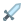 | **Casual** | 1 hour | No | `SVG` | [Open asset](https://cdn.discordapp.com/assets/content/b75fcc4dd1c65dfd4169a203e21023453fd6fe853c9b5c1fd839781fda98e80d.svg) |
| 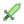 | **Recreational** | 5 hours | No | `SVG` | [Open asset](https://cdn.discordapp.com/assets/content/f0f32cb2a0003475e443b76a7a2baf454356953ecb84195c7a08c3ce2fd95b70.svg) |
|  | **Dedicated** | 20 hours | No | `SVG` | [Open asset](https://cdn.discordapp.com/assets/content/e0c82f41bcad94a2a52713800fbef7687d0d2c6a6066b09d5e5876156d086e1a.svg) |
| 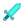 | **Committed** | 75 hours | No | `SVG` | [Open asset](https://cdn.discordapp.com/assets/content/16f2aeb7465c99efce4d67d9333e3ddcf7435d6e60d2f5f93dc0c07bc7c5a69b.svg) |
|  | **Serious** | 150 hours | No | `SVG` | [Open asset](https://cdn.discordapp.com/assets/content/ba26e83fa68189b41837184e38706f41c288dd29ffba266035d1a5ad9adbae22.svg) |
|  | **Devoted** | 300 hours | No | `SVG` | [Open asset](https://cdn.discordapp.com/assets/content/851b194288f1913ece6c8d99976519e48210580d6f42d994f21e37801611ad54.svg) |
| 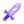 | **Seasoned** | 500 hours | No | `SVG` | [Open asset](https://cdn.discordapp.com/assets/content/8b10f5c0c30abbd521be5afc2e0dd4ec6da18bfbc689f06d93a51d06577cd84a.svg) |
| 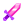 | **Ironclad** | 1,000 hours | No | `SVG` | [Open asset](https://cdn.discordapp.com/assets/content/d705628490898f2cc22d669cf8b415bc03fed1ddaf98a2a8cbd97442a509293c.svg) |
| 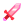 | **Unshakeable** | 2,000 hours | No | `SVG` | [Open asset](https://cdn.discordapp.com/assets/content/2bddcbc9f9959dab805eb7196c8112ce9dc68b09766c8193ab499b1870e44ac7.svg) |
|  | **Eternal** | 5,000+ hours | No | `SVG` | [Open asset](https://cdn.discordapp.com/assets/content/457ce4e657f0ced23197891cc3d75b7de29cafa065cdb8cbb81060ac0e63b07f.svg) |

## Game Variety

| Preview | Badge | Milestone | Legacy | Format | Discord CDN |
| --- | --- | --- | --- | --- | --- |
|  | **Sampler** | 2 games | No | `SVG` | [Open asset](https://cdn.discordapp.com/assets/content/ed18d5976c01a4ea19f5a13af08f0547582405cbe48b098b0822e352b8e0a822.svg) |
|  | **Dabbler** | 5 games | No | `SVG` | [Open asset](https://cdn.discordapp.com/assets/content/e450d5279537db06ee47a104af520b884adaa7ffc3ef2627157526bf1c58e840.svg) |
|  | **Enthusiast** | 10 games | No | `SVG` | [Open asset](https://cdn.discordapp.com/assets/content/158a9d91b8ca9e96d4afeee38cd640fc51483a8196edb9af0c26e44727acafae.svg) |
|  | **Ranger** | 15 games | No | `SVG` | [Open asset](https://cdn.discordapp.com/assets/content/9e491942070007f64011ae4fc478926b96433698c07621fc43bafdd5efe83912.svg) |
|  | **Explorer** | 20 games | No | `SVG` | [Open asset](https://cdn.discordapp.com/assets/content/e25fc55814262150e154ddb1a2b55fc5ed8ed5ba2ff1a22a33d4a41e651e370a.svg) |
|  | **Adventurer** | 30 games | No | `SVG` | [Open asset](https://cdn.discordapp.com/assets/content/542d5277e0001ea738d5eb57b247dcab9ce6e0c29493d5892203f6258fde55b9.svg) |
|  | **Voyager** | 40 games | No | `SVG` | [Open asset](https://cdn.discordapp.com/assets/content/082e693cb9ce98b81af618978d449409efc6522b061bc0eac6e88a949fd888c6.svg) |
|  | **Maverick** | 60 games | No | `SVG` | [Open asset](https://cdn.discordapp.com/assets/content/6fc242e9e8259c471a5e4599cd09af5476e622a572ff235883173913bf506103.svg) |
|  | **Polymath** | 80 games | No | `SVG` | [Open asset](https://cdn.discordapp.com/assets/content/be9a4d119b8e0d7fc1df7e5a12081332637cb9c978a90377cb9c930500b2fbe6.svg) |
|  | **Universalist** | 100+ games | No | `SVG` | [Open asset](https://cdn.discordapp.com/assets/content/fcc34d343451505c642f3397cec2669a2de3a4a410fb968f794b3a1a0dcd1728.svg) |

## Gifting

| Preview | Badge | Milestone | Legacy | Format | Discord CDN |
| --- | --- | --- | --- | --- | --- |
|  | **Patron** | 1 gift | No | `PNG` | [Open asset](https://cdn.discordapp.com/badge-icons/ac305d1b9481f312ce4419e7f8296558.png) |
|  | **Champion** | 2 gifts | No | `PNG` | [Open asset](https://cdn.discordapp.com/badge-icons/8b7792c4f65953d3ff564f23429cb79e.png) |
|  | **Luminary** | 3 gifts | No | `PNG` | [Open asset](https://cdn.discordapp.com/badge-icons/3119f5504b2cd09576a323908c7c3517.png) |
|  | **Icon** | 6 gifts | No | `PNG` | [Open asset](https://cdn.discordapp.com/badge-icons/64f2413c9b9803661322aaad25826b62.png) |
|  | **Hero** | 10 gifts | No | `PNG` | [Open asset](https://cdn.discordapp.com/badge-icons/77d65b1f210014a11eb1582ee06ab684.png) |
|  | **Legend** | 20 gifts | No | `PNG` | [Open asset](https://cdn.discordapp.com/badge-icons/7fe346cfc5da1340087d8759a9e7a395.png) |

## Nitro Subscription Tiers

| Preview | Badge | Milestone | Legacy | Format | Discord CDN |
| --- | --- | --- | --- | --- | --- |
|  | **Bronze** | 1 month | No | `SVG` | [Open asset](https://discord.com/assets/0386191373eb17c272df.svg) |
|  | **Silver** | 3 months | No | `SVG` | [Open asset](https://discord.com/assets/9d4d362c62da3c985845.svg) |
|  | **Gold** | 6 months | No | `SVG` | [Open asset](https://discord.com/assets/8725fe12ada9afa51c1a.svg) |
|  | **Platinum** | 12 months | No | `SVG` | [Open asset](https://discord.com/assets/746689c803e06be87705.svg) |
| 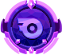 | **Diamond** | 24 months | No | `SVG` | [Open asset](https://discord.com/assets/f3521e2861ff44a0384d.svg) |
|  | **Emerald** | 36 months | No | `SVG` | [Open asset](https://discord.com/assets/f2b9b02fb22cc6459922.svg) |
| 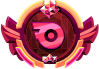 | **Ruby** | 60 months | No | `SVG` | [Open asset](https://discord.com/assets/ecf86e18838013c9d95a.svg) |
| 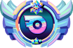 | **Opal** | 72+ months | No | `SVG` | [Open asset](https://discord.com/assets/b4fc7a9c37ec2fae36e3.svg) |

## Server Boost Tiers

| Preview | Badge | Milestone | Legacy | Format | Discord CDN |
| --- | --- | --- | --- | --- | --- |
| 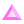 | **Server Boost 1** | 1 month | No | `SVG` | [Open asset](https://discord.com/assets/ca18353be0e57a2b3b3132fa1c08d6b4.svg) |
|  | **Server Boost 2** | 2 months | No | `SVG` | [Open asset](https://discord.com/assets/22f99ed6e34eaca48950254c70f8fe8d.svg) |
| 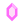 | **Server Boost 3** | 3 months | No | `SVG` | [Open asset](https://discord.com/assets/4a2618502278029ce88adeea179ed435.svg) |
|  | **Server Boost 4** | 6 months | No | `SVG` | [Open asset](https://discord.com/assets/fbafa6adb7c49a6a2c3822521ff2af2f.svg) |
|  | **Server Boost 5** | 9 months | No | `SVG` | [Open asset](https://discord.com/assets/0599f90e32c15b532647163edd72f70a.svg) |
|  | **Server Boost 6** | 12 months | No | `SVG` | [Open asset](https://discord.com/assets/e07c08cdc72bcc78b69c76d2c7ceb344.svg) |
| 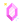 | **Server Boost 7** | 15 months | No | `SVG` | [Open asset](https://discord.com/assets/c7f26927db5e7806790f4e968038630a.svg) |
| 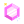 | **Server Boost 8** | 18 months | No | `SVG` | [Open asset](https://discord.com/assets/c6d88d1d12afe03bdc4ebb747f8d196b.svg) |
| 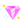 | **Server Boost 9** | 24+ months | No | `SVG` | [Open asset](https://discord.com/assets/d96ed283b74de75692487b7499fb8d09.svg) |

## Data format

Every entry in `data/badges.json` includes the category, badge name, optional milestone, original Discord CDN URL, format, local asset path, `legacy`, `legacy_basis`, `status`, official/unofficial obtainability flags, notes, sources, and the date the status was checked.

## Sync / validate assets

```bash
python scripts/sync_assets.py
```

The script downloads each upstream asset, updates `data/badges.json`, and regenerates this README. It exits non-zero if any CDN asset fails.

## Sources

- [Discord Support — Profile Badges: What Each Badge Means](https://support.discord.com/hc/en-us/articles/44369363856663-Discord-Profile-Badges-What-Each-Badge-Means)
- [Discord Developer Support — Active Developer Badge](https://support-dev.discord.com/hc/en-us/articles/10113997751447-Active-Developer-Badge)
- [Community verification — HypeSquad API flow, updated Oct 13 2026](https://gist.github.com/8ug8ird/2ea887ce56f78c4e31eba4d3a1bfd113)
- Discord Support — Evolving Nitro Badges
- Discord Support — Server Boosting FAQ
- Public Discord badge archives were used to cross-check historical asset hashes and names.

## License & asset rights

The repository code and original metadata are released under the MIT License. **Discord badge artwork and other Discord-owned visual assets are not relicensed by this repository.** See [`NOTICE.md`](NOTICE.md).

